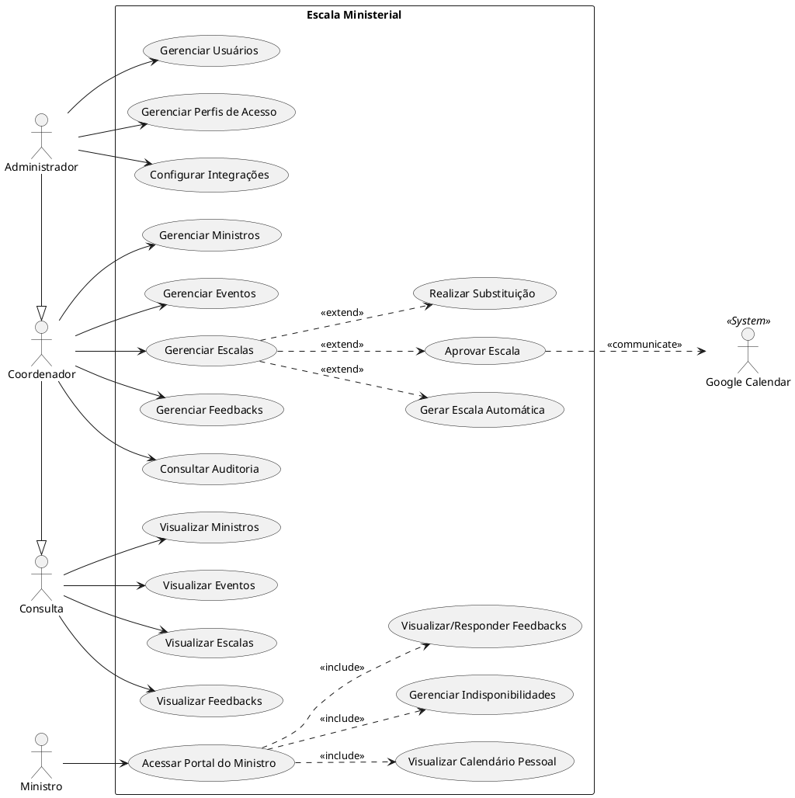

# Documentação de Casos de Uso - Escala Ministerial

Este documento detalha os Casos de Uso do sistema Escala Ministerial, os Atores envolvidos e apresenta o diagrama UML de Casos de Uso.

## Atores

O sistema possui diferentes perfis de acesso, que são representados como atores no diagrama de Casos de Uso, além de integrações externas:

1.  **Administrador:** Possui acesso integral ao sistema. É responsável por gerenciar os usuários do sistema, perfis de acesso, além de ter permissão para visualizar auditoria e todas as funcionalidades de gestão (Coordenador).
2.  **Coordenador:** Gerencia a operação ministerial. É responsável pelo CRUD de ministros, eventos, escalas, feedbacks e visualização de indisponibilidades. Pode também consultar a auditoria do sistema.
3.  **Consulta:** Acesso de apenas leitura aos dados operacionais. Pode visualizar ministros, eventos, escalas e feedbacks, sem a capacidade de alterá-los ou visualizar a auditoria.
4.  **Ministro:** Usuário que atua nos eventos. Tem acesso restrito através do seu "Portal do Ministro" para visualizar seu próprio calendário de escalas, gerenciar suas indisponibilidades (avisar quando não pode participar) e gerenciar/visualizar seus feedbacks.
5.  **Sistema (Google Calendar):** Ator sistêmico/externo que interage com a aplicação enviando convites para os eventos quando as escalas são aprovadas.

## Diagrama de Casos de Uso (UML)

## Descrição dos Casos de Uso

### Grupo: Ministro

*   **Acessar Portal do Ministro:** Autenticação no sistema para acessar funcionalidades exclusivas da própria conta.
*   **Visualizar Calendário Pessoal:** Visualizar os eventos em que o ministro foi escalado.
*   **Gerenciar Indisponibilidades:** Registrar, editar ou excluir datas em que o ministro não poderá participar de eventos. Esta informação é utilizada na geração de escalas para evitar conflitos.
*   **Visualizar/Responder Feedbacks:** Visualizar feedbacks recebidos pelas participações e responder ou comentar os mesmos.

### Grupo: Consulta

*   **Visualizar Ministros, Eventos, Escalas e Feedbacks:** Acesso de apenas leitura aos dados. Permite a visualização das listas, detalhes e históricos, mas sem permissão de alteração (CRUD).

### Grupo: Coordenador

*   **Gerenciar Ministros:** Adicionar (com criação de conta de usuário atrelada), editar, desativar ou remover cadastro de ministros do sistema.
*   **Gerenciar Eventos:** Criar, editar, cancelar e excluir eventos da agenda.
*   **Gerenciar Escalas:** Visualizar, criar manualmente, cancelar ou deletar escalas de eventos.
    *   **Gerar Escala Automática (<<extend>>):** O sistema utiliza as regras de negócio (disponibilidade dos ministros, histórico, etc.) para propor uma escala para o evento.
    *   **Realizar Substituição (<<extend>>):** Em caso de necessidade (como uma indisponibilidade de última hora), permite trocar um ministro escalado por outro, validando disponibilidade.
    *   **Aprovar Escala (<<extend>>):** Confirma a escala, tornando-a oficial. Este caso de uso aciona a integração com o Google Calendar.
*   **Gerenciar Feedbacks:** Criar feedbacks sobre as participações dos ministros, editar e excluir registros de avaliação geral do evento.
*   **Consultar Auditoria:** Acessar logs do sistema que registram quem fez o que e quando, para fins de rastreabilidade.

### Grupo: Administrador

*   **Gerenciar Usuários:** Criar, editar, desativar ou excluir (se permitido) contas de usuários administrativos no sistema, gerindo senhas e status de ativação.
*   **Gerenciar Perfis de Acesso:** Atribuir os perfis (Administrador, Coordenador, Consulta, Ministro) aos usuários, definindo suas permissões no sistema. (Herança: o Administrador também pode fazer todas as ações do Coordenador).
*   **Configurar Integrações:** Parametrizar dados de ambiente (por exemplo, OAuth2 para o Google Calendar).

### Interações Externas

*   **Integração Google Calendar:** Ao Aprovar uma Escala, o sistema sincroniza os dados do evento criando um convite no Google Calendar da conta organizadora e adicionando os ministros como convidados para que recebam e-mails e lembretes.
